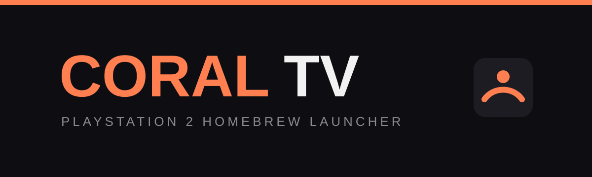

# CORAL TV

<p align="center">
  
</p>

<p align="center">
  <a href="https://github.com/meteoreoise/coral-tv/actions/workflows/build.yml"></a>
  
  
  <a href="LICENSE"></a>
</p>

<div dir="rtl">

## نظرة عامة

**CORAL TV** مشروع Homebrew مفتوح المصدر يحوّل جهاز **PlayStation 2 Slim** إلى مركز ترفيه منزلي بواجهة مستوحاة من تلفازات Smart TV، مع تحكم كامل بواسطة يد DualShock 2.

هذا **ليس** نسخة Android ولا يشغّل ملفات APK. هو برنامج أصلي (ELF) مبني على **PS2SDK** و **gsKit**، ويعمل ضمن حدود عتاد PS2 الحقيقي: ذاكرة 32MB ومعالج Emotion Engine.

> **الشفافية أولاً:** كل ميزة في هذا المستودع موصوفة بحالتها الحقيقية. لا نعلن عن أي دعم قبل اختباره على محاكي أو جهاز حقيقي.

</div>

## الحالة الحالية

| المرحلة | الحالة |
|---|---|
| بناء مشروع PS2SDK + gsKit | **Build-tested** (Docker / GitHub Actions) |
| Phase 1 — ELF قابل للإقلاع وشاشة Home أولية | **Implemented** + **Build-tested** |
| التشغيل على PCSX2 | لم يُختبر بعد |
| التشغيل على جهاز PS2 حقيقي | لم يُختبر بعد |
| الأقسام: Apps / Games / Media / Files / Settings | **Planned** |

الحالات المستخدمة في المشروع: `Planned` — `Implemented` — `Build-tested` — `Emulator-tested` — `Hardware-tested` — `Experimental`.

<div dir="rtl">

## ما يعمل الآن (v0.1.0-dev)

- ملف `coral-tv.elf` يُبنى بنجاح ضد PS2SDK + gsKit.
- تهيئة DMA و GS وفتح شاشة عرض تلقائية حسب منطقة الجهاز.
- شاشة Home أولية: خلفية داكنة، شعار CORAL TV، شريط مرجاني، حالة النظام، ومعلومات الإصدار.
- خط نقطي داخلي 5×7 (بدون ملفات خطوط خارجية) لضمان خفة النظام.
- نظام تسجيل بسيط (`logger`) يطبع عبر console المتاحة.

## المتطلبات

- **Docker Desktop** (الأسهل) أو PS2SDK + gsKit مثبتان يدوياً.
- لفئة الجهاز: PS2 Slim (SCPH-7xxxx / 9xxxx) مع طريقة إقلاع Homebrew.
- لتشغيل الاختبار: PCSX2 (يتطلب BIOS تملكه أنت) أو جهاز حقيقي.

## البناء السريع

```bash
docker run --rm -v "$PWD:/src" -w /src ghcr.io/ps2dev/ps2dev:latest make
```

الناتج: `coral-tv.elf` في جذر المشروع. تفاصيل البناء اليدوي في [docs/BUILD.md](docs/BUILD.md).

## التشغيل

في PCSX2:

1. شغّل PCSX2 مع BIOS الخاص بك.
2. `System → Boot ELF...` واختر `coral-tv.elf`.
3. يجب أن تظهر شاشة CORAL TV بخلفية داكنة وشعار مرجاني.

على جهاز حقيقي: انسخ `coral-tv.elf` إلى USB أو بطاقة ذاكرة، ثم شغّله عبر uLaunchELF / wLaunchELF. سجّل موديل SCPH وطريقة الإقلاع في [docs/TESTING.md](docs/TESTING.md).

## بنية المشروع

```text
.
├── src/
│   ├── main.c              # نقطة الدخول وشاشة Home
│   ├── core/logger.c       # تسجيل بسيط
│   └── graphics/           # renderer + خط 5×7
├── include/coral/          # الترويسات العامة
├── assets/logo/            # شعارات المستودع (وليس أصولاً محمّلة على PS2)
├── docs/                   # البناء، الاختبار، خارطة الطريق، المواصفات
├── .github/workflows/      # بناء آلي للـ ELF
├── Makefile
└── LICENSE
```

## خارطة الطريق

المشروع يُنفّذ على مراحل كما في [docs/ROADMAP.md](docs/ROADMAP.md): الرسوميات ← التحكم ← الأقسام ← مشغل ELF ← مدير الملفات ← الوسائط والإعدادات ← الإصدار المستقر.

## المساهمة

اقرأ [CONTRIBUTING.md](CONTRIBUTING.md). القاعدة الأهم: لا تُعلن ميزة مكتملة قبل بنائها واختبارها، واذكر حالة الاختبار بدقة.

## الترخيص وإخلاء المسؤولية

كود CORAL TV مرخّص تحت [MIT](LICENSE). يعتمد المشروع على [PS2SDK](https://github.com/ps2dev/ps2sdk) و [gsKit](https://github.com/ps2dev/gsKit) (رخصة AFL-2.0) — التفاصيل في [docs/THIRD_PARTY.md](docs/THIRD_PARTY.md).

المشروع غير مرتبط بـ Sony Interactive Entertainment. لا يتضمن المستودع BIOS أو ألعاباً تجارية أو أي محتوى محمي بحقوق النشر، ولا يقوم بتعديل ملفات النظام الأصلية.

</div>

<p align="center">
  <a href="README_EN.md">English documentation →</a>
</p>
